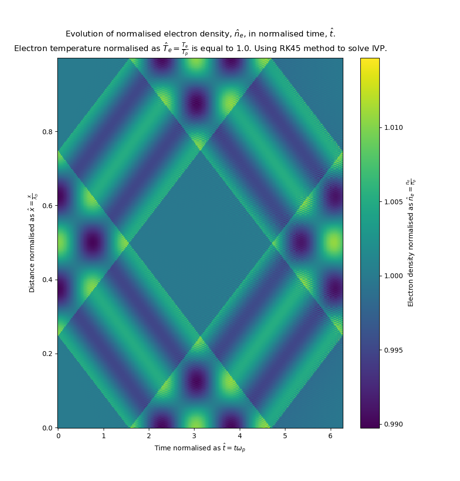
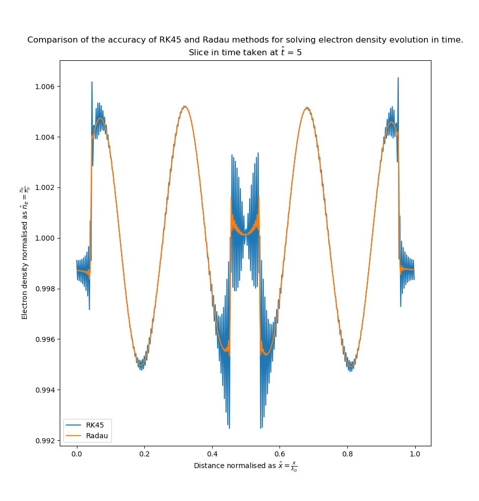

# Computational portfolio 3 - Plasma waves

Using python and SciPy to simulate a one dimensional periodic plasma. See `Portfolio3.pdf` for the context behind this code. See `Computational_Plasma_Physics__Portfolio_Assignment_3.pdf` for a full write up.

## Usage

After cloning the repo run `simulate_plasma_waves.py` in an IDE of your choice or by entering the following command in the command line:
```
python3 simulate_plasma_waves.py
```
This will calculate and plot the electric field before solving the initial value problems (using initial $n_e$ and $U_e$ set by functions `initial_ne` and `initial_Ue`) for $T_e = 0$ and $T_e = 1$ using both RK45 and Radau.

## Application


Electron density normalised as $\hat{n}_e = \frac{n_e}{n_p}$ shown in colour (where yellow is a higher density) plotted against distance normalised as $\hat{x} = \frac{x}{\lambda_D}$ on the y-axis and time normalised as $\hat{t} = t\omega_p$ on the x-axis. Electron density at $\hat{t} = 0$ is equal to $1$ in the first and last quarter of the distance range and defined by $\hat{n}_e = 1 + 0.01 \sin (8\pi \hat{x})$ in the centre. Electron temperature normalised as $\hat{T}_e = \frac{T_e}{T_p}$ is equal to $0$. The method used for solving the initial value problem is RK45.

In the areas where initial electron density is 1 there is no further oscillation in $\hat{n}_e$ as time progresses. In the areas where initial electron density is not equal to 1 there is a temporal oscillation in $\hat{n}_e$ about $\hat{n}_e = 1$ with a period of 2$\pi$ and a maximum amplitude of 0.01. The waves do not propagate in space as time progresses.


Electron density normalised as $\hat{n}_e = \frac{n_e}{n_p}$ shown in colour (where yellow is a higher density) plotted against distance normalised as $\hat{x} = \frac{x}{\lambda_D}$ on the y-axis and time normalised as $\hat{t} = t \omega_p$ on the x-axis. Electron density at $\hat{t}=0$ is equal to 1 in the first and last quarter of the distance range and defined by $\hat{n}_e = 1 + 0.01 \sin{(8\pi \hat{x})}$ in the centre. Electron temperature normalised as $\hat{T}_e = \frac{T_e}{T_p}$ is equal to 1. The method used for solving the initial value problem is RK45.

With an electron temperature of 1 the electron density oscillation now propagate through space in the positive and negative directions from the centre point with a normalised velocity of ~0.17. 
With $\hat{T}_e \neq 0$ the $\frac{d\hat{n}_e}{d\hat{x}}$ term in $\frac{d\hat{U}_e}{d\hat{t}} = \frac{\hat{q}_e}{\hat{m}_e} \hat{E}_x - \frac{\hat{T}_e}{\hat{m}_e \hat{n}_e} \frac{d\hat{n}_e}{d\hat{x}}$ becomes non-zero. This represents a force on the electrons accelerating them through space caused by the electron density gradient in $\hat{x}$. 

## Solving using Radau


Electron density normalised as $\hat{n}_e = \frac{n_e}{n_p}$ shown in colour (where yellow is a higher density) plotted against distance normalised as $\hat{x} = \frac{x}{\lambda_D}$ on the y-axis and time normalised as $\hat{t} = t \omega_p$ on the x-axis. Electron density at $\hat{t}=0$ is equal to 1 in the first and last quarter of the distance range and defined by $\hat{n}_e = 1 + 0.01 \sin{(8\pi \hat{x})}$ in the centre. Electron temperature normalised as $\hat{T}_e = \frac{T_e}{T_p}$ is equal to 1. The method used for solving the initial value problem is Radau.


The electron density in space is being taken at $\hat{t}$ = 5. The evolution of electron density in time is being simulated using both the RK45 and Radau methods when computing the IVP. RK45 is in blue and Radau is in orange.

Using Radau over RK45 produces a much less noisy result at later times. With this simulation being stiff due to the large range in time scales, an implicit method like Radau is able to resolve the essential structure of the solution without relying on very small time steps. Whereas the explicit RK45 would need to be run with smaller time steps to get the same accuracy.

